## Lab1

Entity và quan hệ:

| Entity | Fields chính | Quan hệ |
| --- | --- | --- |
| Book | title, isbn, price_vnd, stock | N:1 Category; N:M Author |
| Author | name, bio | N:M Book |
| Category | name, slug | 1:N Book |
| Review | rating, book_id, user_id | N:1 Book; N:1 User |
| User | email, display_name | 1:N Review |

Endpoint:

| Endpoint | Method |
| --- | --- |
| `/api/v1/books` | GET, POST |
| `/api/v1/books/{id}` | GET, PUT, DELETE |
| `/api/v1/books/{id}/authors` | GET, POST |

Chạy server:
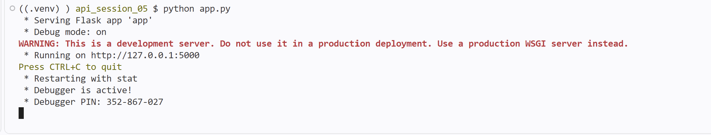

Kết quả test GET danh sách sách (200 OK):
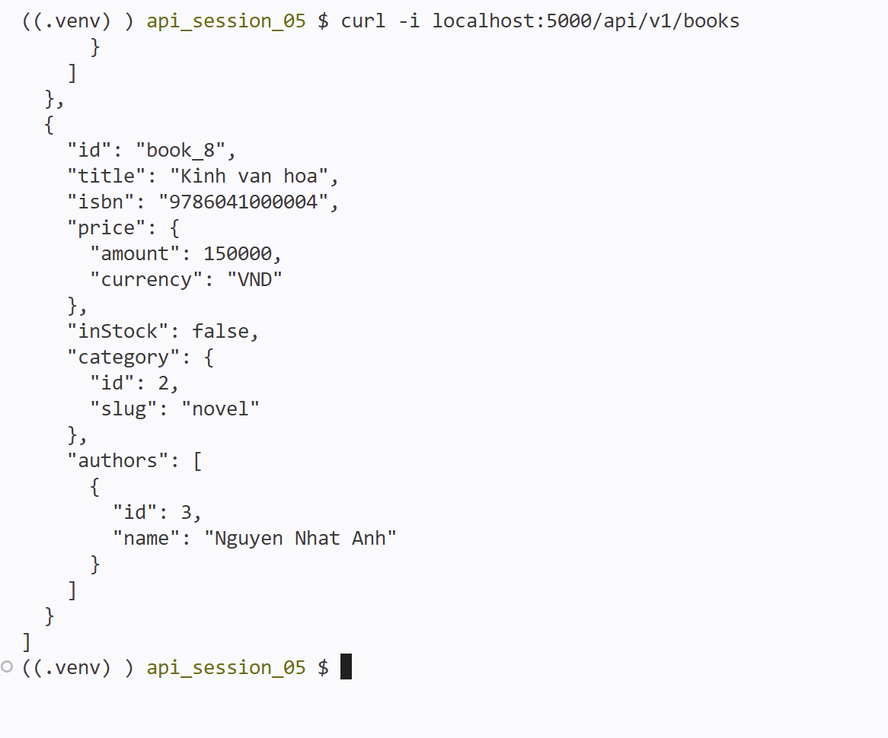

Kết quả test POST tạo sách mới (201 Created):
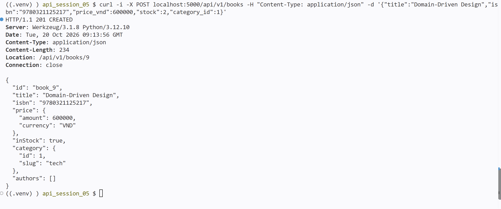

Kết quả test POST sai schema (400 Bad Request):
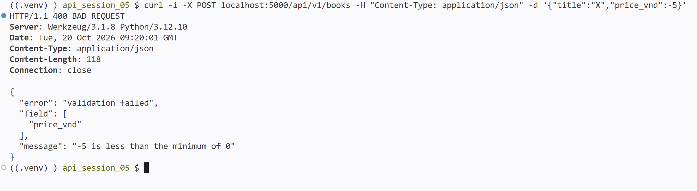

Kết quả test xem tác giả của sách (200 OK):
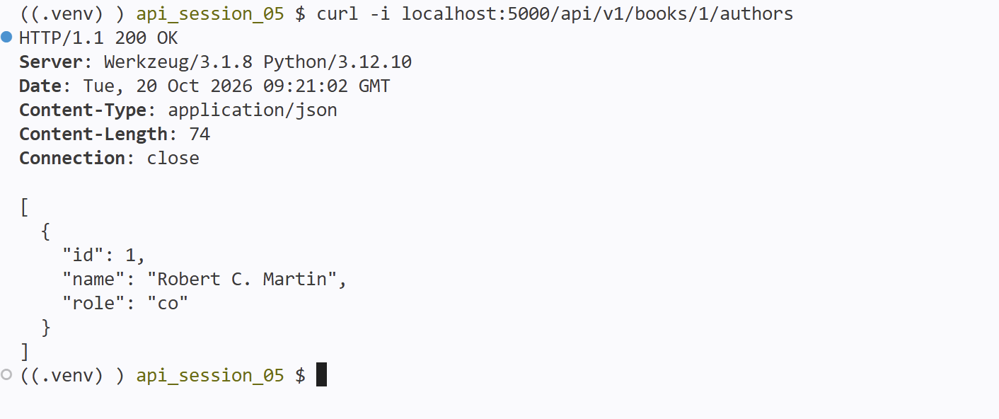

## Lab2

Chạy server:
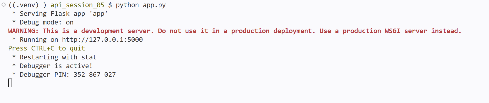

Kết quả test phân trang (limit=3), có cursor trang sau:
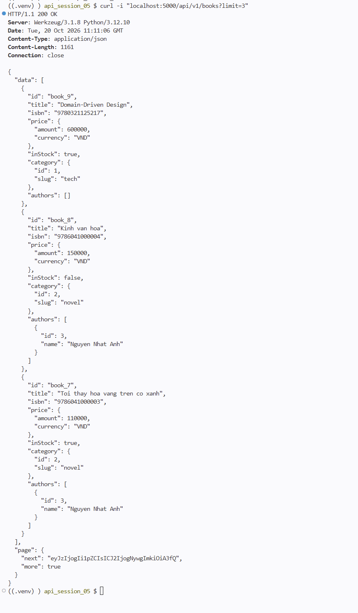

Kết quả test lấy trang tiếp theo bằng cursor:
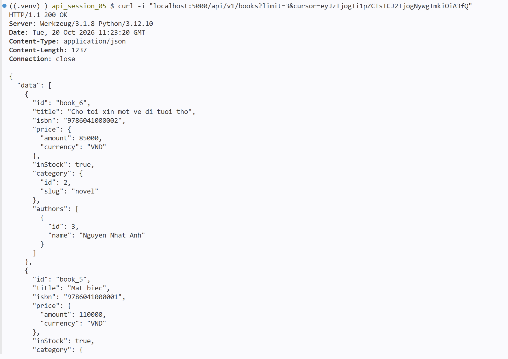

Kết quả test lọc theo thể loại và sắp xếp giá giảm dần (category=2&sort=-price):
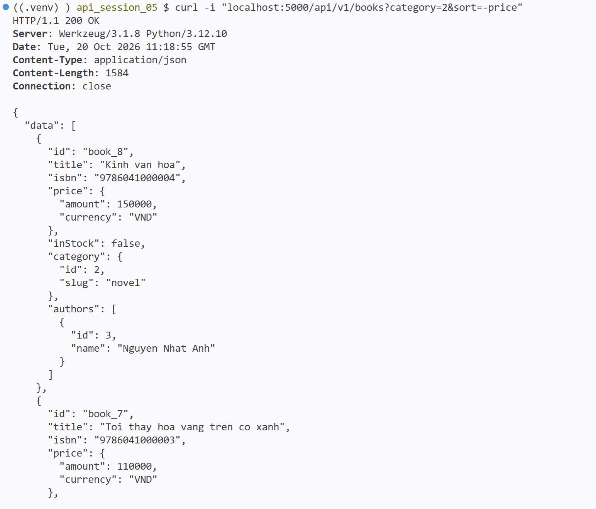

Kết quả test sort không hợp lệ (400 Bad Request):
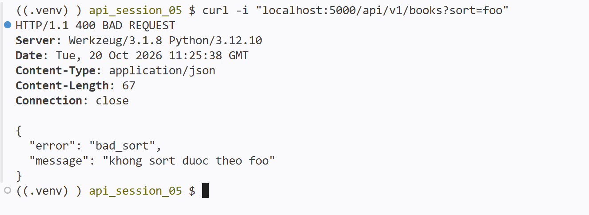

## BTVN2

Tham số của `GET /api/v1/books`:

| Tham số | Ý nghĩa |
| --- | --- |
| `strategy` | `cursor` (mặc định) hoặc `offset` |
| `limit` | số sách mỗi trang, mặc định 20, tối đa 100 |
| `offset` | vị trí bắt đầu, dùng với `strategy=offset` |
| `cursor` | lấy từ `page.next` của trang trước, dùng với `strategy=cursor` |
| `genre` | lọc theo thể loại, vd `tech`, `novel` |
| `sort` | sort nhiều cột, vd `-price,title` (`-` là giảm dần) |

Kết quả chạy test:
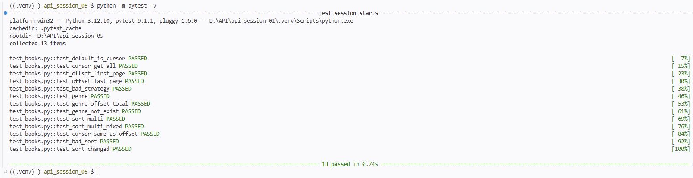

Kết quả chạy Postman collection ([bookstore.postman_collection.json](postman/bookstore.postman_collection.json)):
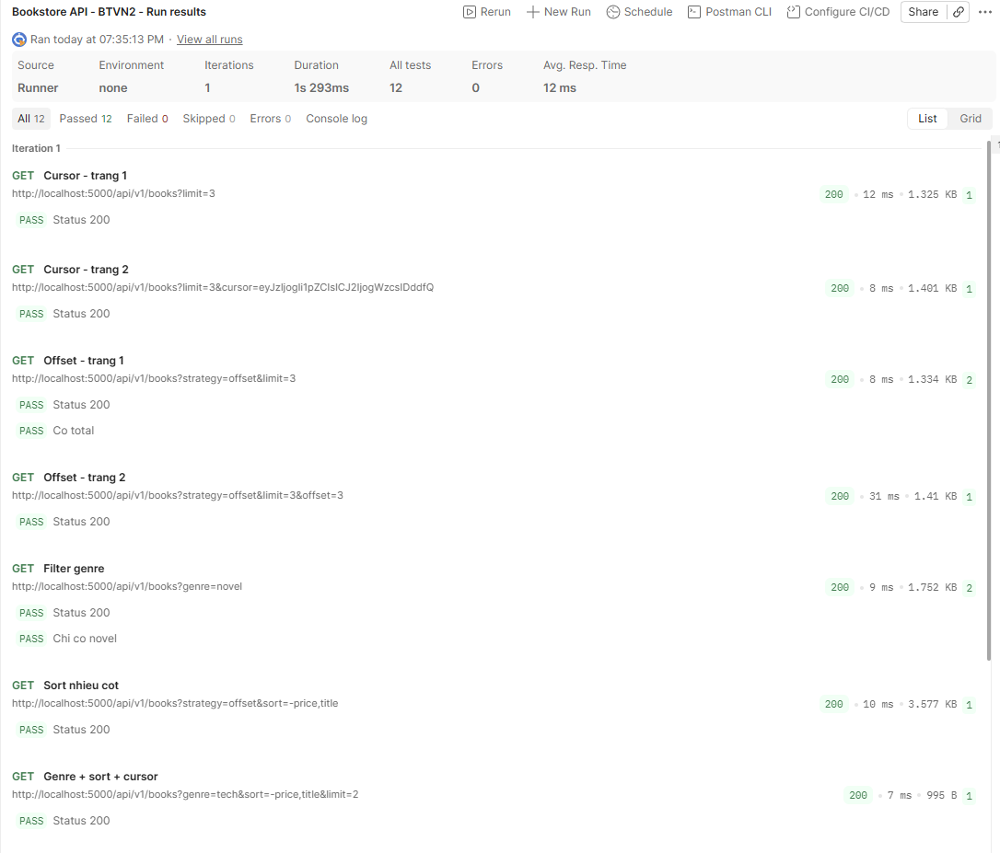
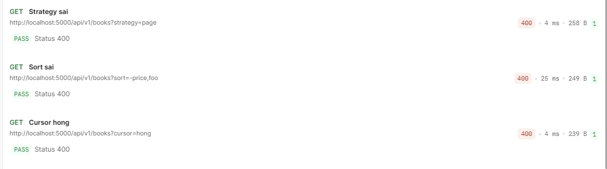
