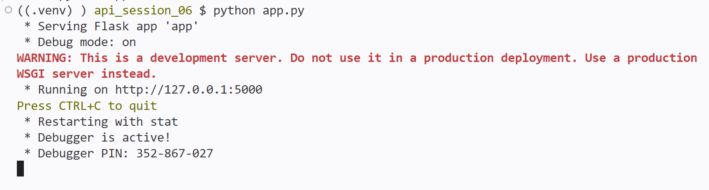
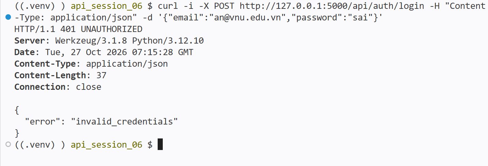
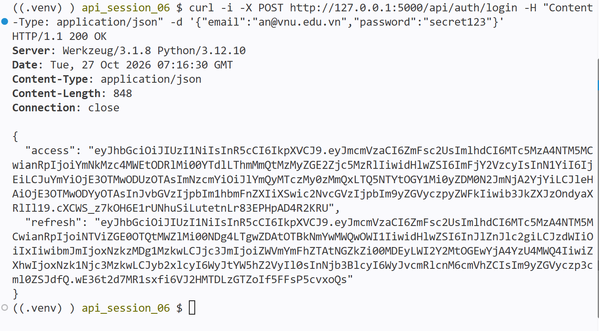
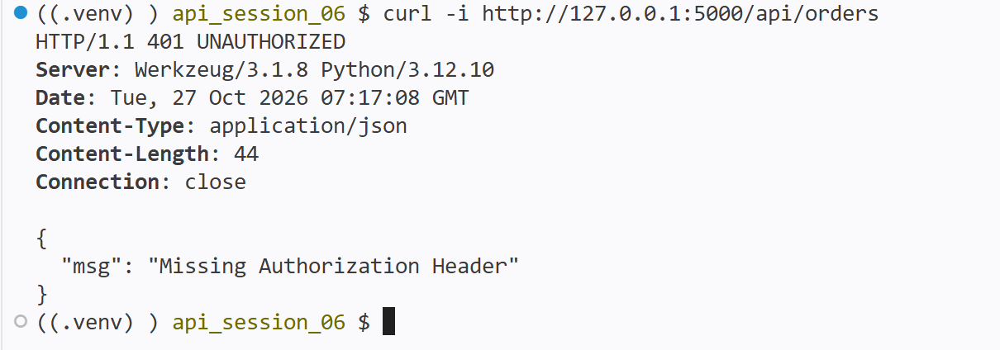
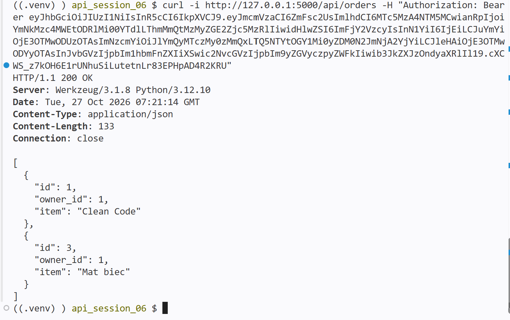
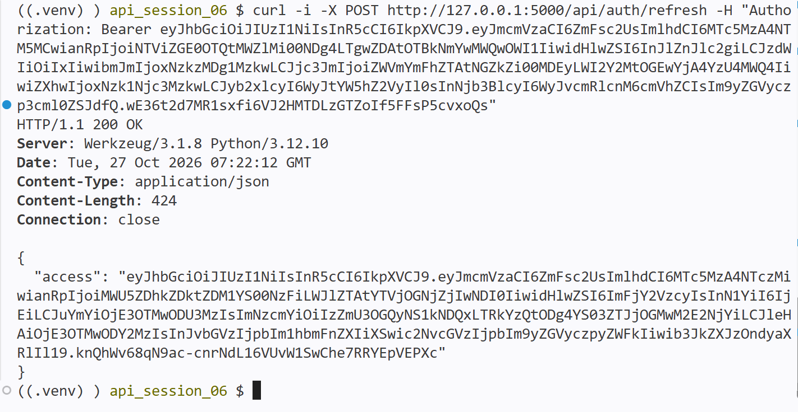
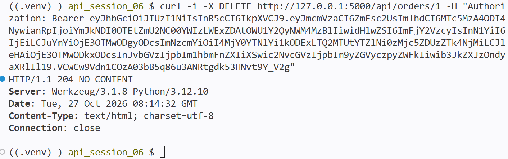
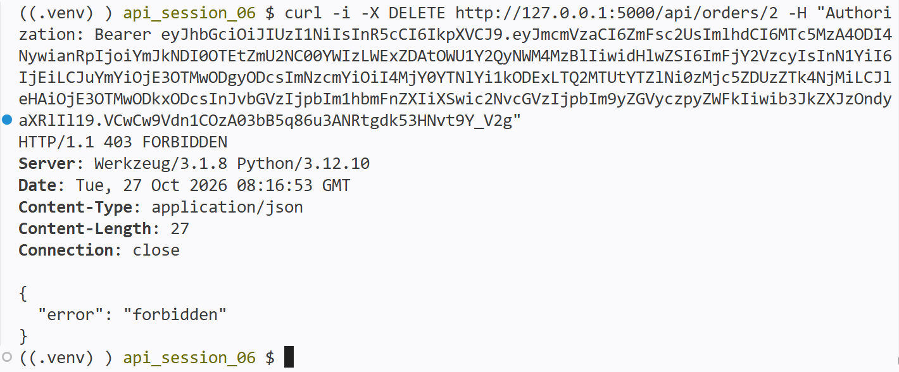
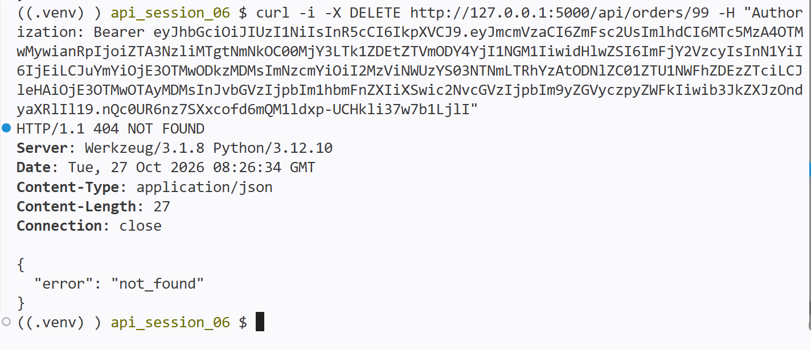
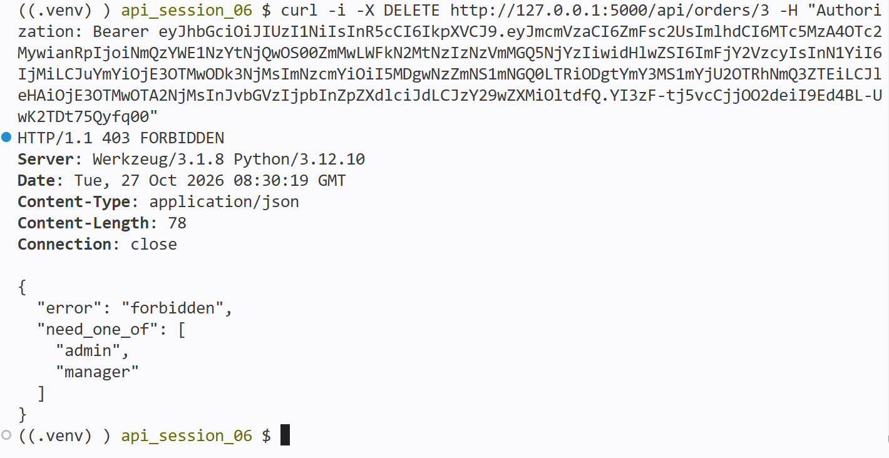

## Lab1

User mẫu (mật khẩu đều là `secret123`, lưu dạng hash bcrypt):

| Email | Role | Scope |
| --- | --- | --- |
| an@vnu.edu.vn | manager | orders:read, orders:write |
| binh@vnu.edu.vn | manager | orders:read, orders:write |
| chi@vnu.edu.vn | viewer | (không có) |

Endpoint:

| Endpoint | Method | Mô tả |
| --- | --- | --- |
| `/api/auth/login` | POST | đăng nhập, trả về access + refresh token |
| `/api/auth/refresh` | POST | dùng refresh token lấy access token mới |
| `/api/orders` | GET | cần access token và scope `orders:read` |

Chạy server:

Kết quả test đăng nhập sai mật khẩu (401 Unauthorized):

Kết quả test đăng nhập đúng (200 OK, trả về access + refresh):

Kết quả test gọi `/api/orders` không có token (401 Unauthorized):

Kết quả test gọi `/api/orders` có token (200 OK):

Kết quả test refresh lấy access token mới (200 OK):

## Lab2

`DELETE /api/orders/{id}` có 3 lớp check (code trong `auth.py`):

| Lớp | Decorator | Lỗi |
| --- | --- | --- |
| Role | `require_roles("admin", "manager")` | 403 nếu không có role nào |
| Scope | `require_scopes("orders:write")` | 403 nếu thiếu scope |
| Chủ order | `user_owns_resource("id")` | 404 nếu không có order, 403 nếu không phải chủ (chống BOLA) |

Kết quả test xoá order của chính mình (204 No Content):

Kết quả test xoá order của người khác (403 Forbidden):

Kết quả test xoá order không tồn tại (404 Not Found):

Kết quả test user không có role manager/admin (403 Forbidden):
