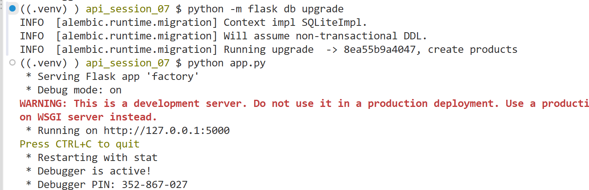
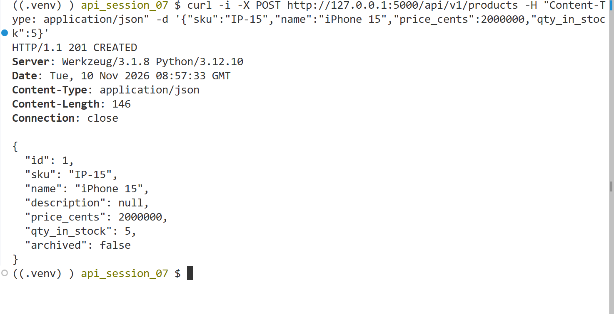
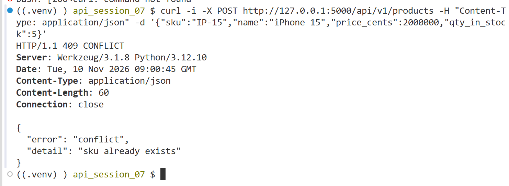
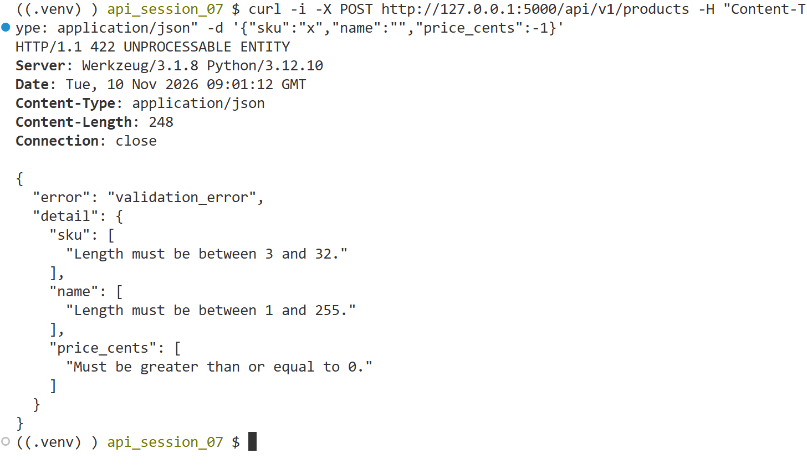
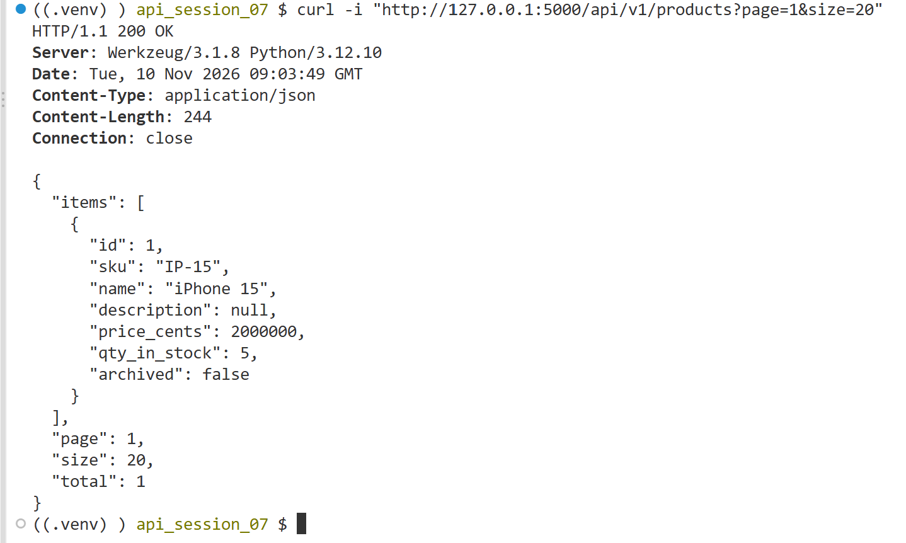
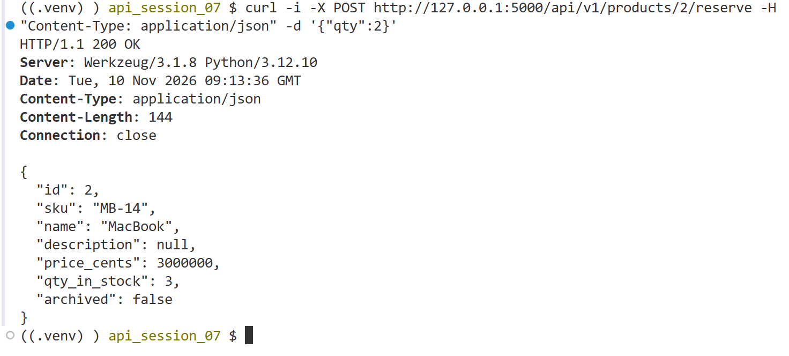
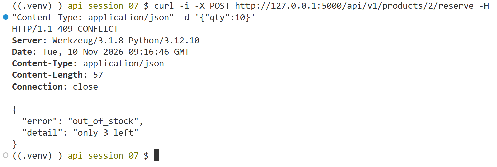
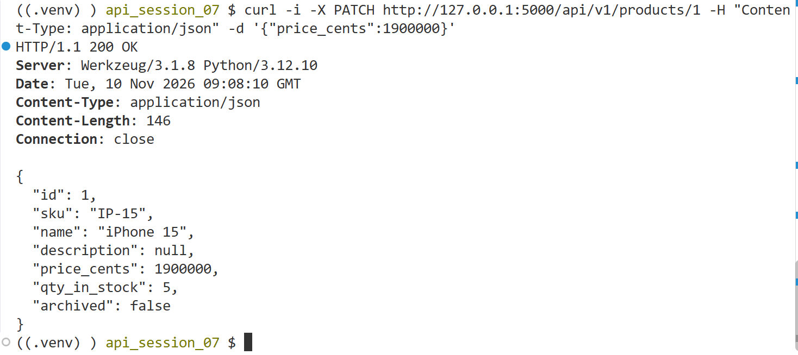
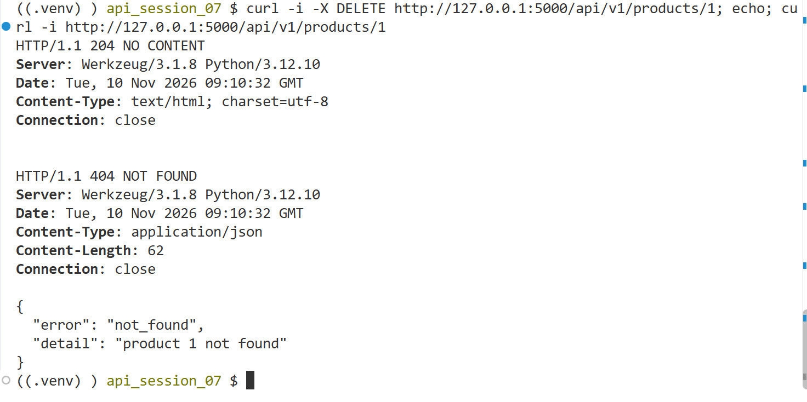

## Lab1

Product API dùng application factory, blueprint, SQLAlchemy 2.x, marshmallow và Flask-Migrate (SQLite `instance/dev.db`).

| File | Vai trò |
| --- | --- |
| `factory.py` | `create_app()` gắn config, db, migrate, blueprint, error handler |
| `config.py` | cấu hình đọc từ biến môi trường (`DB_URL`, `SECRET_KEY`) |
| `extensions.py` | `db`, `migrate` khai báo ở module-level |
| `models.py` | model `Product` |
| `schemas.py` | 4 schema: `ProductOut`, `ProductIn`, `ProductPatch`, `ReserveIn` |
| `products.py` | blueprint `/api/v1/products`, 6 endpoint |
| `errors.py` | `ApiError` và handler trả `{"error", "detail"}` |
| `migrations/` | revision tạo bảng `products` |

| Endpoint | Method | Mô tả |
| --- | --- | --- |
| `/api/v1/products?page=1&size=20` | GET | danh sách có phân trang, bỏ qua sản phẩm đã xoá |
| `/api/v1/products/<id>` | GET | lấy 1 sản phẩm, 404 nếu không có |
| `/api/v1/products` | POST | tạo sản phẩm, 409 nếu sku trùng, 422 nếu dữ liệu sai |
| `/api/v1/products/<id>/reserve` | POST | đặt trước, giảm `qty_in_stock`, 409 nếu hết hàng |
| `/api/v1/products/<id>` | PATCH | chỉ đổi field có trong body |
| `/api/v1/products/<id>` | DELETE | soft-delete (`archived=true`) |

Chạy migration và server:

Kết quả test tạo sản phẩm (201 Created):

Kết quả test tạo trùng sku (409 Conflict):

Kết quả test dữ liệu sai (422 Unprocessable Entity):

Kết quả test lấy danh sách có phân trang (200 OK):

Kết quả test đặt trước 2 sản phẩm (200 OK, `qty_in_stock` giảm):

Kết quả test đặt trước quá số lượng còn (409 Conflict):

Kết quả test cập nhật giá (200 OK):

Kết quả test xoá rồi lấy lại sản phẩm (204 No Content, sau đó 404 Not Found):
