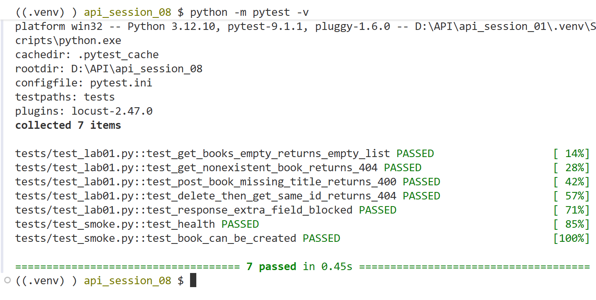
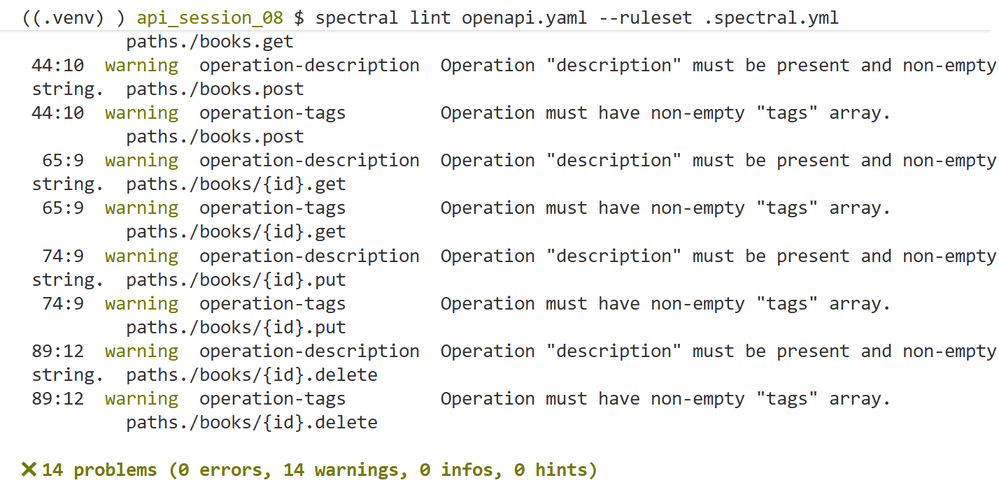
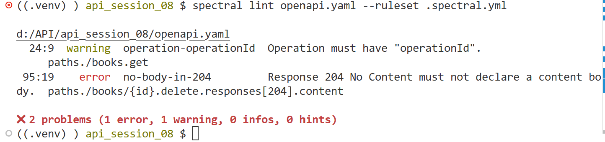
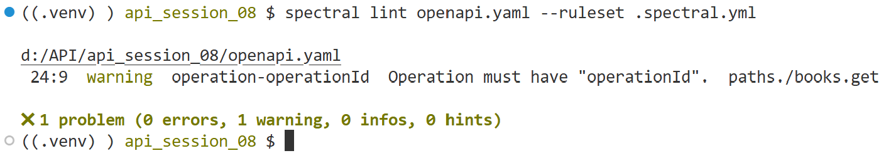
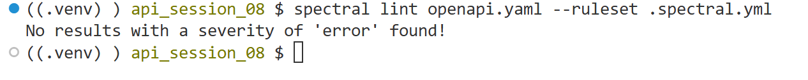
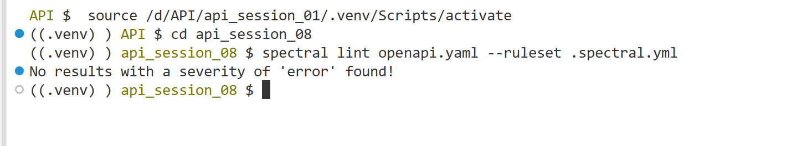

# Lab01

Kết quả test:

# Lab02

Kiểm tra lần đầu:

Kiểm tra sau khi thêm luật 204:

Kiểm tra sau khi fix 204:

Kiểm tra sau khi fix operationId:

Custom rule trong `.spectral.yml`:
- `no-body-in-204`: response 204 không được khai báo `content`.
- `response-200-not-empty`: response 200 phải có schema ít nhất 1 trường (có `properties` hoặc là mảng có `items`).
- `book-year-integer`: `Book.year` phải là `integer` giống model.

Kiểm tra sau khi fix year:

Spec pass Spectral nhưng Flask trả sai field thì Spectral không bắt được vì nó chỉ đọc file spec. Phải dùng pytest + jsonschema, lấy response thật rồi validate theo schema trong `openapi.yaml` (giống test bonus ở Lab 1).