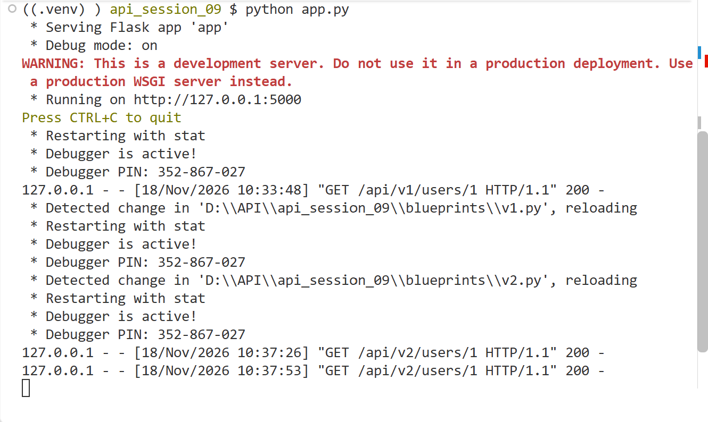
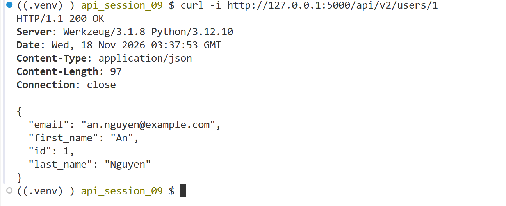
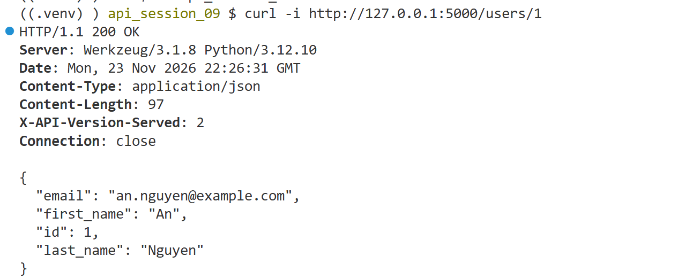
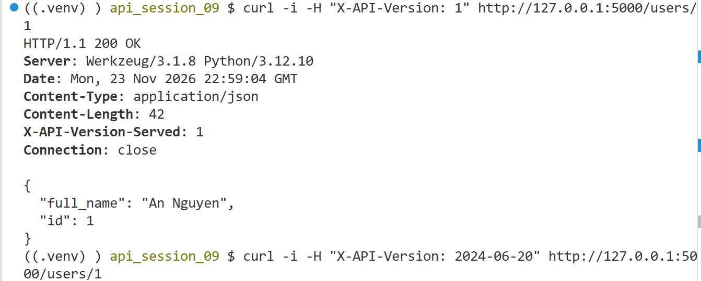
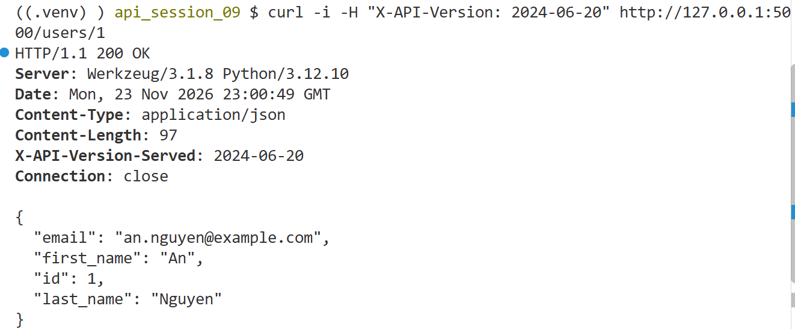

# Lab01

Chạy server:

Kết quả gọi v1 (trả `full_name`):

Kết quả gọi v2 (tách `first_name`, `last_name`):

# Lab02

Chạy server:

Không gửi header (mặc định v2):

`X-API-Version: 1` (trả `full_name`):

`X-API-Version: 2024-06-20`:

`X-API-Version: 99` (version lạ trả 400, không fallback):

