# Lab01

Chạy server:

Kết quả gọi v1 (trả `full_name`):
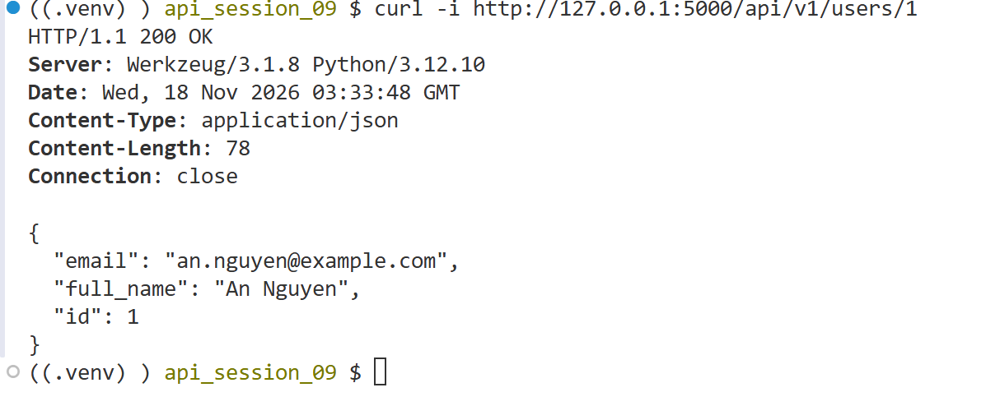

Kết quả gọi v2 (tách `first_name`, `last_name`):

# Lab02

Chạy server:
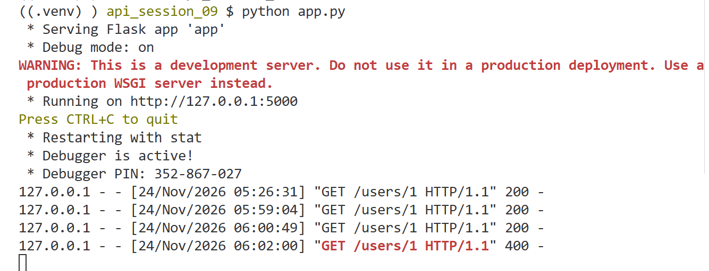

Không gửi header (mặc định v2):

`X-API-Version: 1` (trả `full_name`):

`X-API-Version: 2024-06-20`:

`X-API-Version: 99` (version lạ trả 400, không fallback):
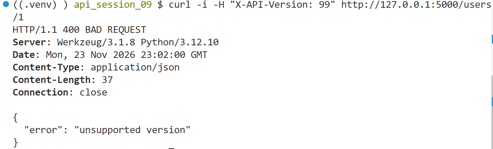

# Lab03

Thêm `sunset.py` có decorator `@deprecate_at(date)`, gắn vào route v1 trong `blueprints/v1.py` (sunset 31/12/2026). Trước ngày sunset trả 200 kèm header `Sunset`, `Deprecation: true`, `Link` tới v2; sau ngày sunset trả 410 Gone. Thêm route `/api/v0/users/{id}` có ngày sunset đã qua (01/01/2026) để test trường hợp 410.

Chạy server (mỗi lần gọi v1 log `deprecated_call`):
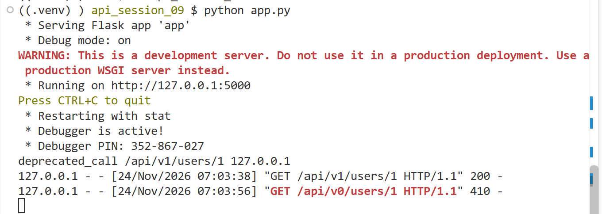

Gọi v1 trước sunset (200, có `Sunset`, `Deprecation`, `Link`):
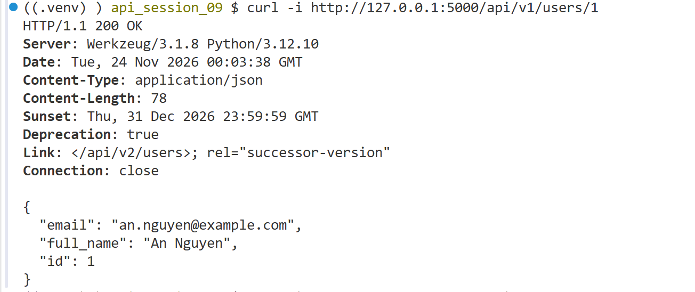

Gọi v0 sau sunset (410 Gone):
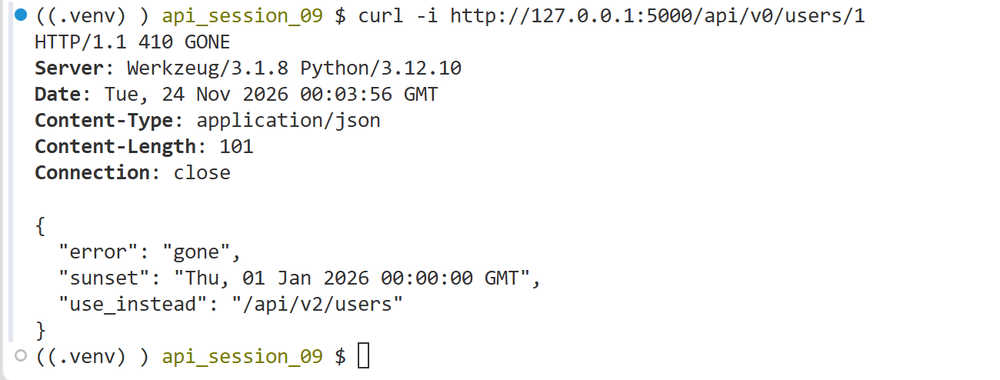

# Mở rộng: POST /users cho v2

Tạo user (201) và thiếu field (400):
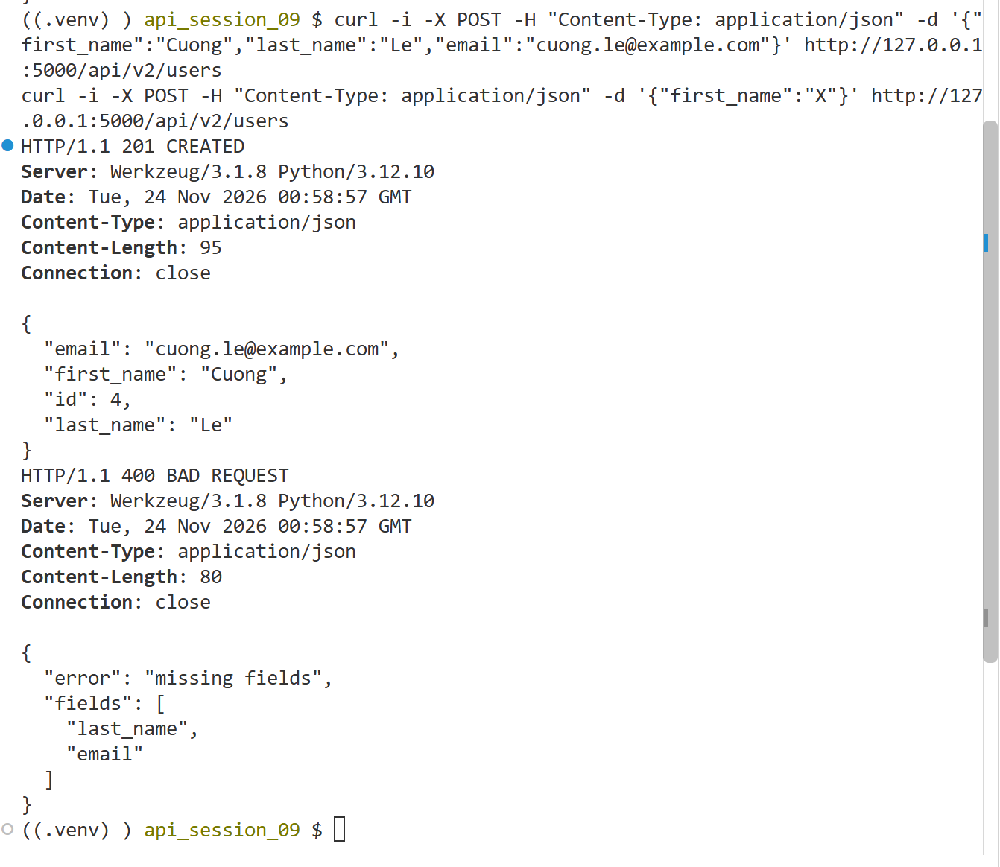

Đọc lại user vừa tạo qua v1, v2:
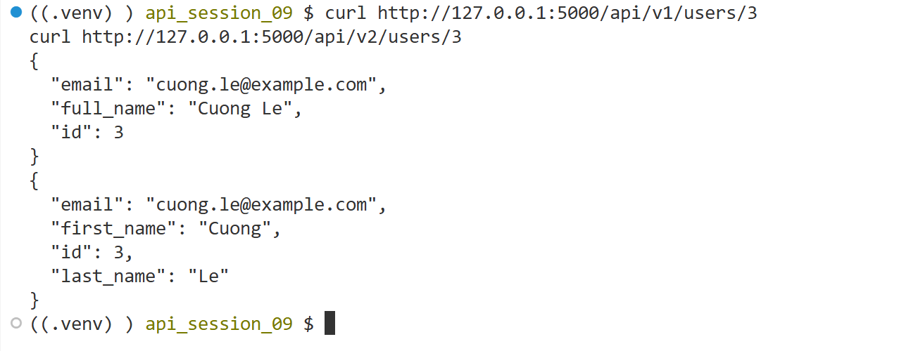

# Mở rộng: OpenAPI spec

Kết quả Spectral (warning còn lại do v0 đã sunset, chỉ trả 410):
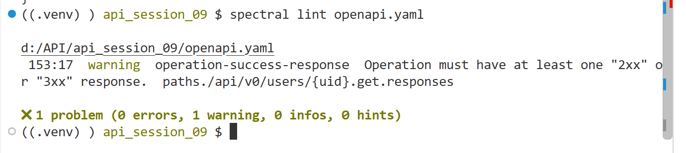

# Lab04

Chạy server:
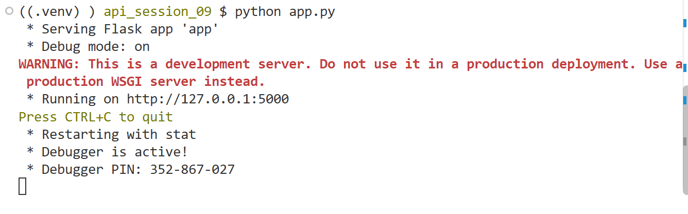

`X-Cohort: beta` vào v2:
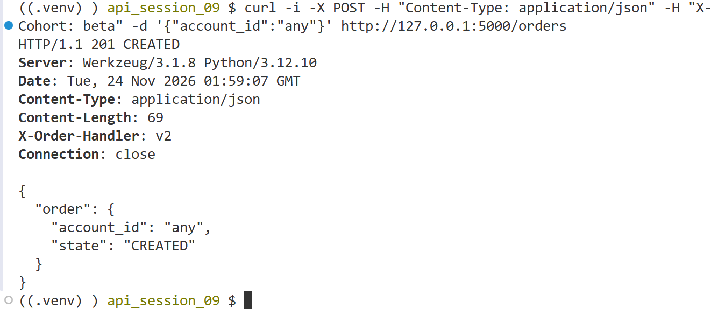

`acct_42` (allow-list) vào v2:
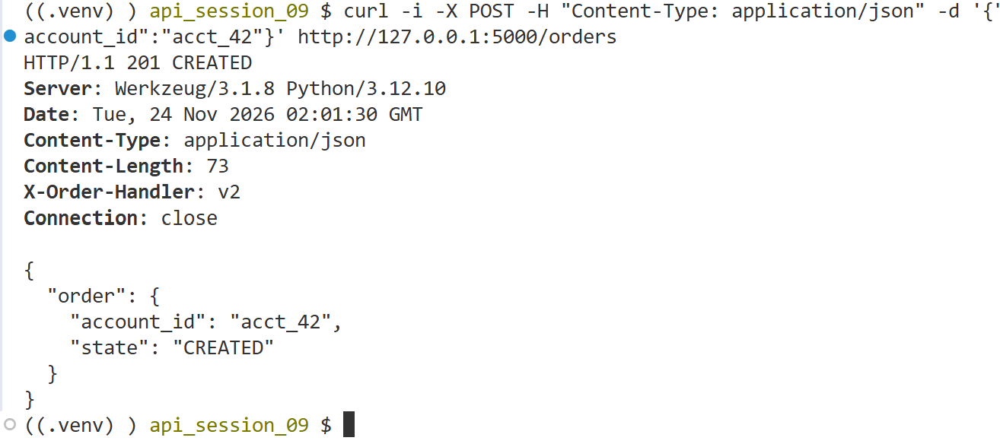

Bucket 5%: `acct_1` vào v1, `acct_72` vào v2:
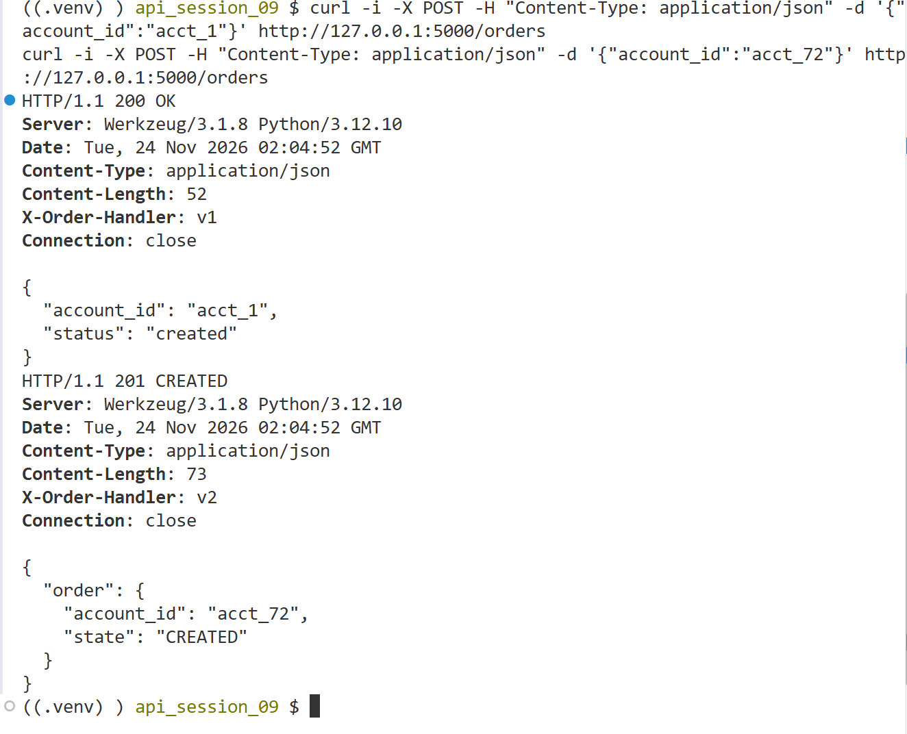

`V2_PERCENT = 100`: `acct_1` vào v2:
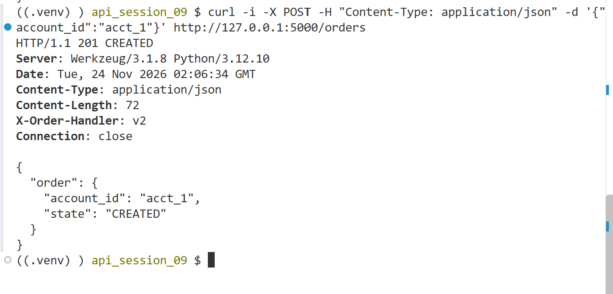